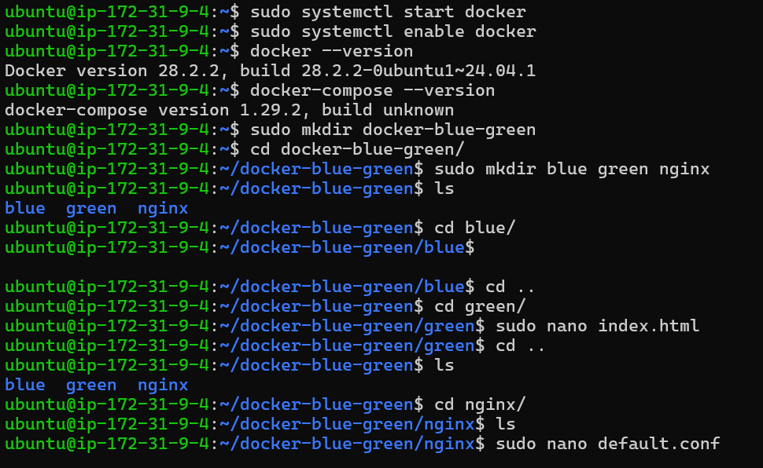
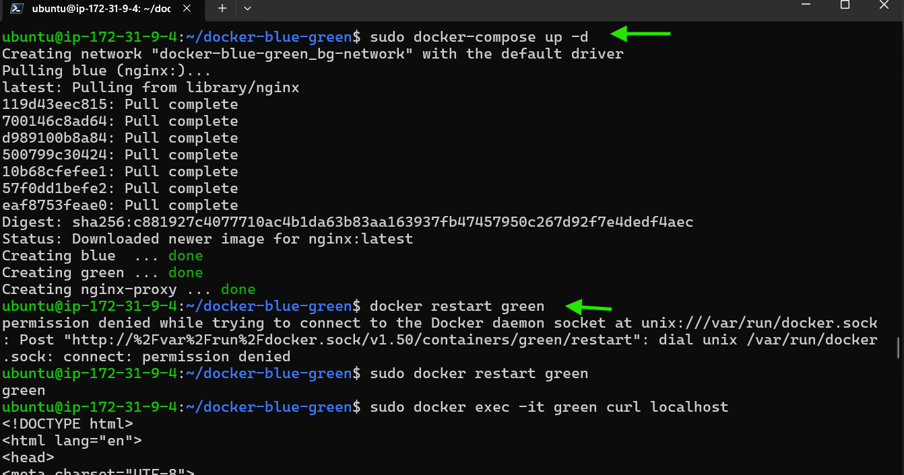
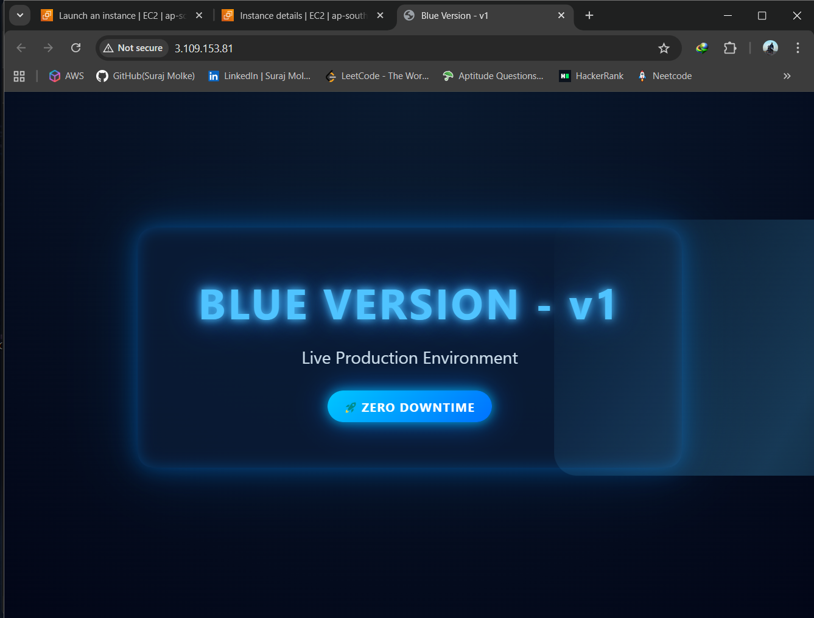
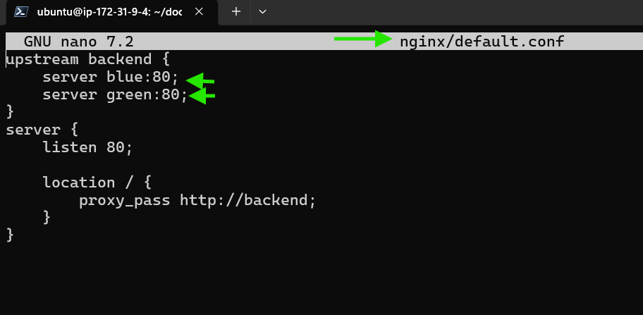
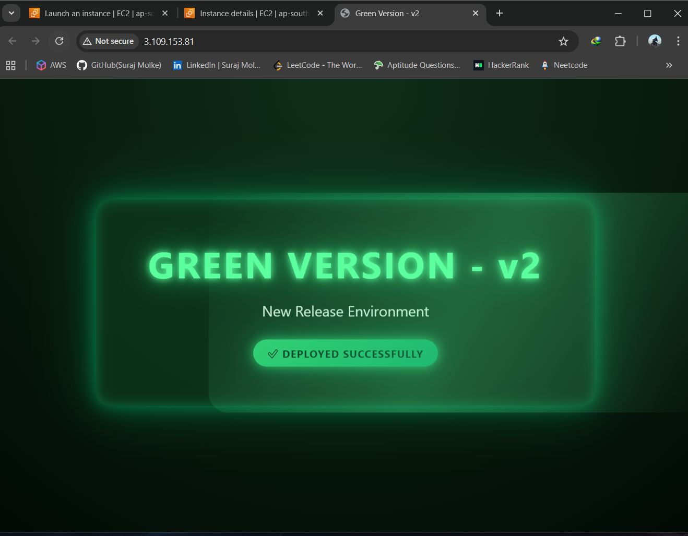

# 🐳 Docker Blue-Green Deployment (Zero Downtime)

This project demonstrates **Docker-based Blue-Green Deployment** using **Nginx as a reverse proxy** to achieve **zero downtime releases**.

---

## 📌 Architecture

```
User
  |
  v
Nginx (Reverse Proxy)
  |
  +--> Blue Container (v1)
  |
  +--> Green Container (v2)
```

---

## 🛠️ Tech Stack
- Linux (Ubuntu)
- Docker
- Docker Compose
- Nginx
- HTML + CSS

---

## 📁 Project Structure

```
docker-blue-green/
│
├── blue/
│   └── index.html
├── green/
│   └── index.html
├── nginx/
│   └── default.conf
└── docker-compose.yml
```

---

## 🔧 Step 1: Install Docker & Docker Compose

```bash
sudo apt update
sudo apt install docker.io docker-compose -y
sudo systemctl start docker
sudo systemctl enable docker
docker --version
docker-compose --version
```

---

## 🔵 Step 2: Blue Version HTML (v1)

**blue/index.html**
```html
<!DOCTYPE html>
<html>
<head>
<title>Blue Version</title>
<style>
body {
    margin:0;
    height:100vh;
    display:flex;
    justify-content:center;
    align-items:center;
    background:radial-gradient(circle,#0a1a2f,#020617);
    color:#4fc3ff;
    font-family:Arial;
}
.container {
    text-align:center;
    padding:60px;
    border-radius:20px;
    background:rgba(10,30,60,.7);
    box-shadow:0 0 40px #2196f3;
}
h1 {
    font-size:3.5rem;
    text-shadow:0 0 20px #4fc3ff;
}
</style>
</head>
<body>
<div class="container">
<h1>BLUE VERSION - v1</h1>
<p>Live Production</p>
</div>
</body>
</html>
```

---

## 🟢 Step 3: Green Version HTML (v2)

**green/index.html**
```html
<!DOCTYPE html>
<html>
<head>
<title>Green Version</title>
<style>
body {
    margin:0;
    height:100vh;
    display:flex;
    justify-content:center;
    align-items:center;
    background:radial-gradient(circle,#0f2f1a,#020a05);
    color:#5cff9d;
    font-family:Arial;
}
.container {
    text-align:center;
    padding:60px;
    border-radius:20px;
    background:rgba(15,60,30,.7);
    box-shadow:0 0 40px #2ecc71;
}
h1 {
    font-size:3.5rem;
    text-shadow:0 0 20px #5cff9d;
}
</style>
</head>
<body>
<div class="container">
<h1>GREEN VERSION - v2</h1>
<p>New Release</p>
</div>
</body>
</html>
```

---

## ⚖️ Step 4: Nginx Reverse Proxy Config

**nginx/default.conf**
```nginx
upstream backend {
    server blue:80;
    # server green:80;
}

server {
    listen 80;
    location / {
        proxy_pass http://backend;
    }
}
```

---

## 🐳 Step 5: Docker Compose File

**docker-compose.yml**
```yaml
version: '3'
services:
  blue:
    image: nginx
    volumes:
      - ./blue:/usr/share/nginx/html
    networks:
      - bgnet

  green:
    image: nginx
    volumes:
      - ./green:/usr/share/nginx/html
    networks:
      - bgnet

  nginx:
    image: nginx
    ports:
      - "80:80"
    volumes:
      - ./nginx/default.conf:/etc/nginx/conf.d/default.conf
    depends_on:
      - blue
      - green
    networks:
      - bgnet

networks:
  bgnet:
```

---

## ▶️ Step 6: Start Project

```bash
docker-compose up -d
docker ps
```

Access:
```
http://<server-ip>
```

---

## 🔀 Step 7: Switch Traffic (Zero Downtime)

Edit `nginx/default.conf`:
```nginx
upstream backend {
    # server blue:80;
    server green:80;
}
```

Reload Nginx:
```bash
docker exec nginx nginx -s reload
```

---

## 🔄 Step 8: Rollback

```nginx
upstream backend {
    server blue:80;
    server green:80;
}
```

```bash
docker exec nginx nginx -s reload
```

---


## 🎯 Key Highlights
- Zero downtime deployment
- Instant rollback
- Docker networking
- Production-style reverse proxy

---

## 📄 Resume Line
**Docker Blue-Green Deployment with Zero Downtime using Nginx Reverse Proxy**

---

## 👨‍💻 Author
Suraj Molke
